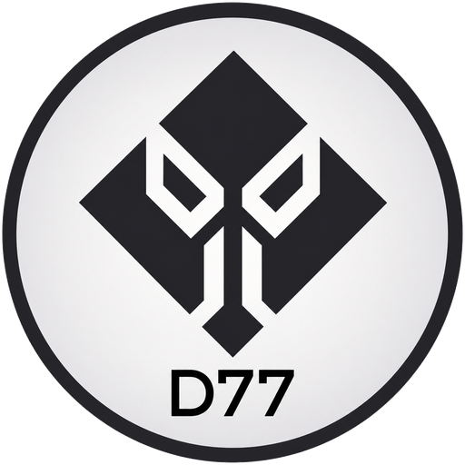

<p align="center">
  
</p>

<h1 align="center">wmd77</h1>

<p align="center">
  A Penrose based X11 Tiling Window Manager written for d77void.
</p>

---


Since the first release, a few additions have been made, namely:

- Monocle, Grid, Fibonacci and Tatami layouts;

- Window rules for some programs;

- A scratchpad;

- A more complete status bar script;

- A session menu to logout, reboot and shutdown (requires dmenu);

- A `config.toml` for themes, applications, window rules and keybindings,
  reloaded in place with super + shift + r or `SIGHUP`;

- The built-in bar can be switched off to run an external one (polybar,
  lemonbar, ...).

## Build Dependencies

- cargo & rust

- libX11-devel, libXft-devel

- make

## Running Dependencies

- dbus

- dmenu

- st 

- JetBrainsMono Nerd Font (the bar font of every built-in theme)

### Optional dependencies

- setxkbmap and xset (only for the `[keyboard]` section of `config.toml`)

- dunst

- feh

- redshift

- scrot

- slock

- sxhkd

- udiskie

- xautolock

- xcompmgr

# Build / Install

To build and use locally:

```
$ make
```

And then run the package:

```
$ target/release/./wmd77
```

To install widely:

```
$ sudo make install
```

## Configuration

wmd77 works without any configuration file. To change something, copy the
example and uncomment what you need:

```
$ mkdir -p ~/.config/wmd77
$ cp /usr/share/wmd77/config.toml.example ~/.config/wmd77/config.toml
```

The file uses the same format as [pwm](https://github.com/dani-77/pwm)'s:
`[theme]` (built-in themes `d77`, `gruvbox_dark`, `arc_dark`, `dracula`,
`tokyo_night`, or your own palette), `[apps]` (terminal, launcher, locker,
startup script), `[[window_rule]]`, `[[float_rule]]` and `[[bind]]`
(remap or add keybindings). A theme only changes colors and the bar font;
the wallpaper still comes from `startup.sh`.

`[keyboard]` sets the XKB layout, variant, model and options (with
`setxkbmap`) and the key repeat delay and rate (with `xset r rate`); only
what you set is touched.

`[bar]` is wmd77's own: `enable = false` drops the built-in bar, and
`reserve_top` keeps room at the top of the screen for an external bar
started from `startup.sh`.

Apply changes with super + shift + r, or from a script with
`pkill -HUP -x wmd77`: wmd77 restarts in place and your windows stay open.
[Kantele](https://github.com/dani-77/kantele) can edit the file for you.

## Keybinds

Eventhough you can swap any of it, by default:

super + return -> st (suckless terminal)

super + d -> dmenu (suckless menu)

super + shift + f -> full screen toggle

super + j/k -> swap focused window

super + shift + j/k -> swap position focused window

super + m -> change layout

super + q -> kill focused window

super + s -> scratchpad toggle

super + x -> session menu

super + shift + q -> quit WM

super + shift + r -> reload config.toml

# Credits

- Huge thanks to [sminez](https://github.com/sminez) for the fantastic Penrose Library, examples and HowTo videos in Youtube.


Happy hacking!

